# Light Chord: Engineering Requirements

## Summary

Light Chord is a tool for the **Light Phone III** (LP3) for playing songs on
acoustic guitar hands free. It is a small song library, browsed by artist. Open
a song and its lyrics scroll by on their own with the chords printed above the
words (Cifra Club style). The **hardware wheel sets the scroll speed**, and the
screen stays awake while a song is open. Pause the song and tap a chord to see
its fretboard diagram.

- **Platform:** Android tool built with Light's SDK ([lightphone/light-sdk](https://github.com/lightphone/light-sdk)).
  This repo is a copy of upstream; all tool code lives in `tool/`.
- **Song format:** [ChordPro](https://www.chordpro.org/chordpro/chordpro-introduction/)
  files (`.cho`, `.chopro`, `.txt`). v1 is a reader: it never parses Cifra Club
  or any website.
- **Getting songs on the phone:** uploaded from a computer through Light's
  **Tool Manager** (browser UI over local Wi-Fi). No typing on the LP3.
- **UI:** monochrome LightOS look, large type, 2–3 lyric lines on screen,
  English and Portuguese strings.
- **Reference:** [christianlacerda/light-habit](https://github.com/christianlacerda/light-habit)
  is an earlier LP3 tool by the same author. Its conventions and lessons apply
  (listed under Constraints).

## Screenshots

These are mockups at LP3 proportions (1080×1240 display, shown at half size). The interactive
canvas is at https://claude.ai/artifact/En4J11aJHLnHCfhsGbW8zB.

| Artists (home) | Songs by artist | Song, scrolling | Song, paused |
|---|---|---|---|
| 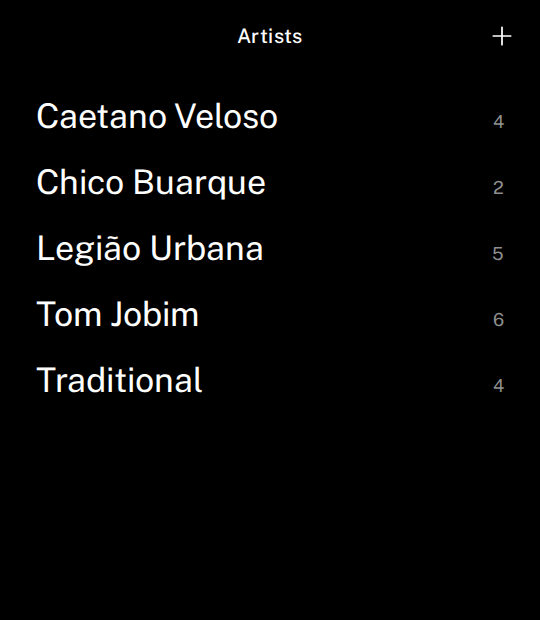 | 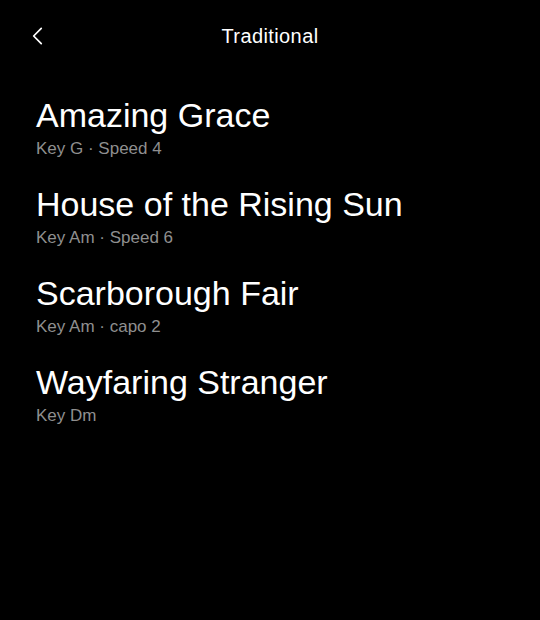 | 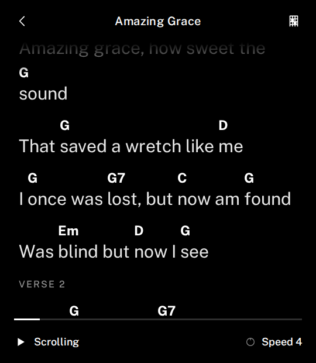 | 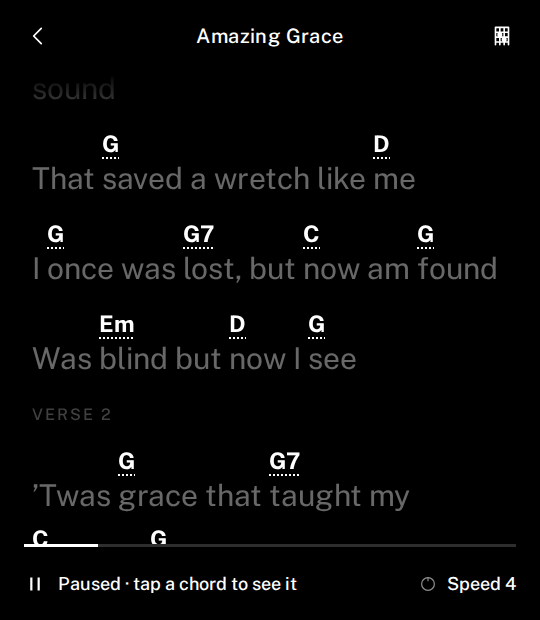 |
| **Chord diagram** | **Wheel turned** | **Chords in this song** | **Add songs** |
| 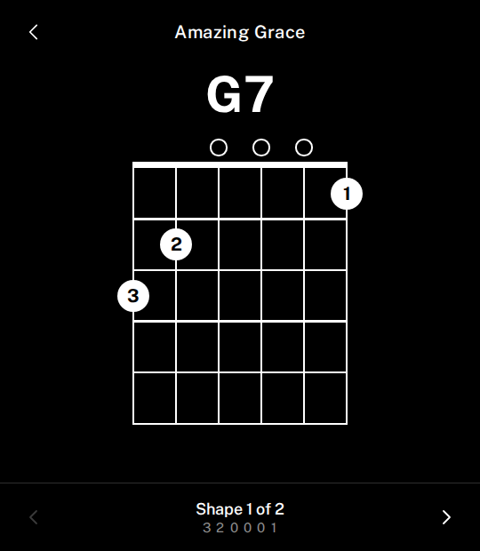 | 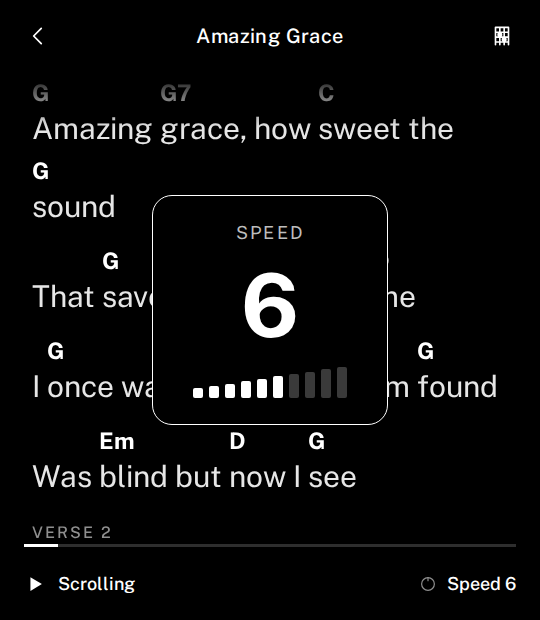 | 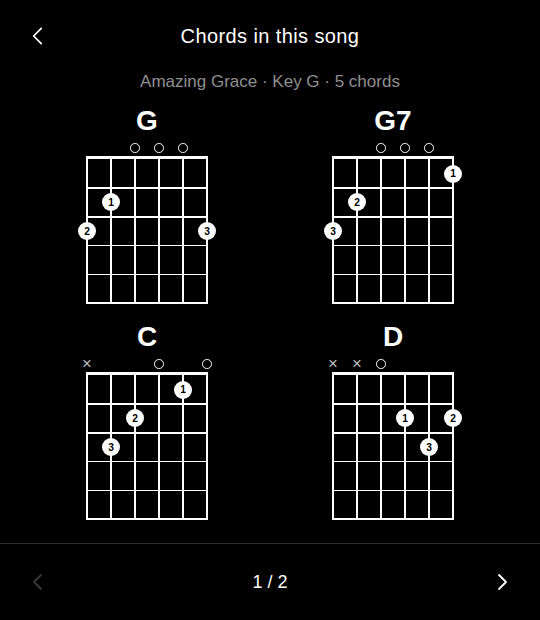 | 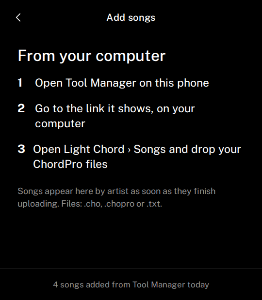 |

Behaviour shown in the mockups:

- **Song view.** Content scrolls up smoothly. Bottom bar: play/pause glyph,
  state text, `Speed N` (1–10), and a thin progress line. Tapping the lyrics
  toggles pause. A song opens paused at the top.
- **Paused.** Lyrics dim, and chord names get a dotted underline and become
  tappable. Chords are never tappable while scrolling.
- **Chord diagram.** Full screen: 6 strings × 5 frets, finger numbers in dots,
  `o`/`×` above the nut, a barre bar, and a base-fret label (`3fr`). Arrows or
  the wheel cycle through shapes. Back returns to the song, still paused.
- **Wheel.** Each step changes speed by 1. The value flashes large with a 10-step
  meter for ~1 s. Speed is saved per song.
- **Chords in this song.** Opened from the grid icon in the song's top bar. Shows
  every chord in order of first use, in its easiest shape, 4 per page.

## Architecture

### Components

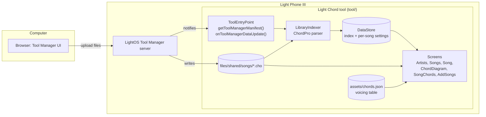

### Navigation

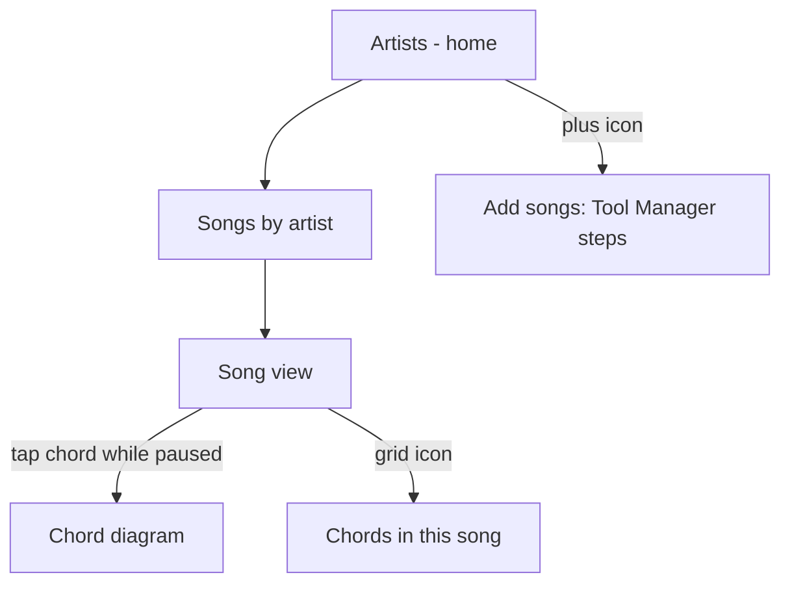

Use one `LightScreen` + `LightViewModel` per screen. `@InitialScreen` is `ArtistsScreen`.
Navigate with `navigateTo(::Screen)` and go back with `goBack()`. The SDK draws
the back bar.

### Data model

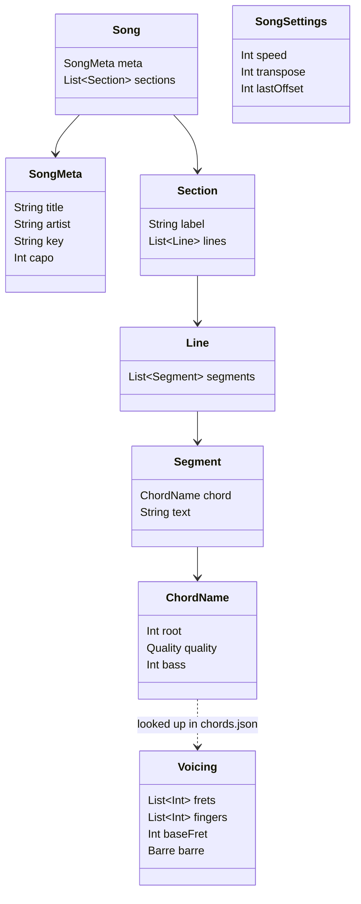

- **Nullability:** `key`, `capo`, `label`, `chord`, `bass` and `barre` are optional.
  `root`/`bass` are pitch classes 0–11. `frets`/`fingers` have 6 entries, low E
  to high e. `speed` is 1–10.
- **ChordPro subset to parse:** `{title}`, `{artist}`, `{key}`, `{capo}`,
  `{comment}`/`{c}`, `{start_of_verse}`/`{sov}`, `{start_of_chorus}`/`{soc}`,
  `{start_of_tab}` (rendered monospace), and inline `[Chord]` before a syllable.
  Unknown directives are ignored. A file with no title falls back to its file
  name, and no artist means "Unknown artist".
- **Rendering:** each line is a flow of `Segment`s with the chord drawn above
  its text. A line too long for the screen wraps **between segments** at render
  time, so a chord never moves off its syllable. Chords are bold; lyrics are
  regular weight in large type.
- **Voicings:** a hand-checked JSON table bundled in `assets/`. It holds open
  shapes plus movable E- and A-shape barres stored once and shifted to each
  root. Frets go low E to high e, `null` = muted, `0` = open. Diagrams are drawn
  with a Compose `Canvas` in theme colours.
- **Storage:** song files stay as uploaded in `files/shared/songs/`. The index
  (artist → songs) and `SongSettings` are JSON in the tool's
  `DataStore<Preferences>` (the same pattern as light-habit), and are rebuilt
  on `onToolManagerDataUpdate()` and on app start.

### Platform hooks

| Need | How |
|---|---|
| File upload | `lighttool.toml` `capabilities = ["tool-manager-provider"]`. `ClientToolManifest` with `FileBrowserSpec(label="Songs", path="songs")`. See upstream `docs/tool_manager`, `examples/tool-manager-demo`. |
| Wheel | Unverified. It either arrives as key events (consume in the screen's `onKeyDown`) or as rotary/scroll motion events (Compose `onRotaryScrollEvent` / pointer scroll). Check with `examples/ui-demo` Key Events screen. |
| Screen awake | `LocalView.current.keepScreenOn = true`, set only while the Song view is showing. |
| Auto-scroll | `withFrameNanos` loop advancing a scroll offset by `speed × k` px/s. Stops at end and shows "End". |

### Constraints (lessons from light-habit)

- The screen is a **27 × 31 grid** (`LightGrid`). Size layouts in grid units
  (`gridUnitsAsDp`) and use the `LightText` variants.
- **No ADB on production LP3.** Install through Tool Manager over Wi-Fi.
  Develop against the LightOS emulator first (`serverPackage =
  "com.thelightphone.sdk.emulator"`, build with
  `-DlightSdk.allowAltServerPackage=true`). Switch to `com.lightos` for the
  device.
- **No orientation lock.** `portrait` letterboxes on the near-square LP3.
- `getSystemService` is blocked, so there are no alarms or notifications.
- Only the allowlisted permissions and capabilities are allowed
  (`plugin/.../LightToolMetadata.kt`). Light's builder compiles only
  `tool/lighttool.toml`, `tool/build.gradle.kts` and
  `tool/src/main/{kotlin,java,res,assets}`, so keep all tool code there and
  leave the SDK modules untouched to match upstream.
- Localize the label with `label = "@string/tool_name"` (`values/`,
  `values-pt/`): "Chords" in English, "Cifras" in Portuguese.
- Monochrome UI. Read colours from `LightThemeController`, never hard-code them.

## Roadmap

**v0: device checks (before writing features)**
1. Does the installed LightOS support `tool-manager-provider`? Run
   `examples/tool-manager-demo`.
2. What does the wheel send? Run `examples/ui-demo` → Key Events.
3. Does `keepScreenOn` keep the LP3 awake?
4. Is smooth scrolling steady on the display, and how many characters fit per
   line at the chosen font size?

**v1: ChordPro reader**
- Artists → Songs → Song view with auto-scroll, wheel speed, pause on tap and screen awake.
- Chord diagram on tap while paused, plus the "Chords in this song" sheet.
- Tool Manager upload into `songs/`, library re-index, and delete a song.
- Bundled sample songs (public domain) for development and the empty state.
- English and Portuguese UI.
- Unit tests for the ChordPro parser, line wrapping, transposition maths and
  voicing lookup.

**v1.1**
- Add a song by scanning a QR code of a link to one ChordPro file
  (`LightQrCodeScanner`, `CAMERA`, `INTERNET`), with a check-and-save screen.
- Transpose and capo per song. Font size setting.

**Later**
- Cifra Club import: on the phone, through a "Send to Light Chord" Chrome extension, or a
  reverse QR flow (the LP3 shows a QR code, another phone sends songs).
- Optional next-chord diagram while scrolling (off by default). Tuner.
